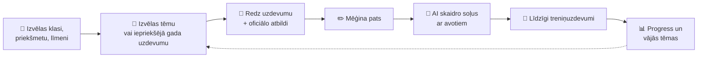
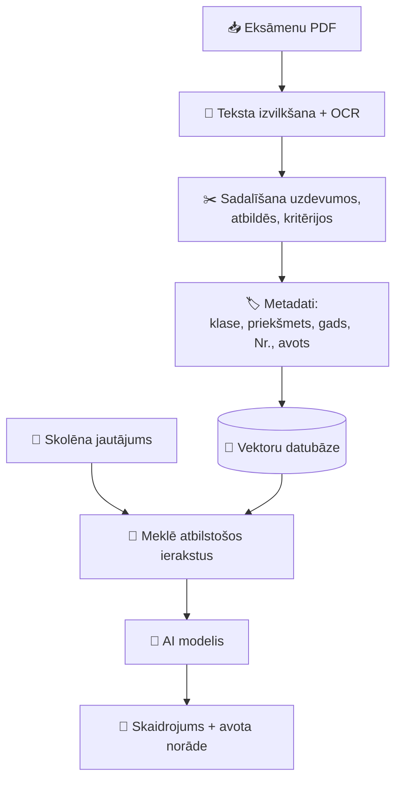
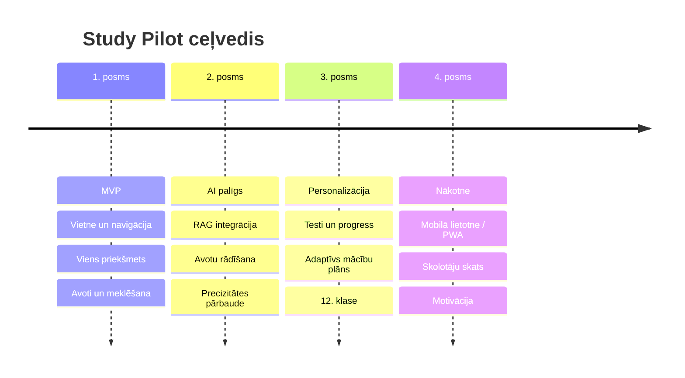

<div align="center">

# 🧭 Study Pilot

### Tavs mācību pilots ceļā uz 9. un 12. klases eksāmeniem

*Plāno. Trenējies. Saproti. Uzvari.*

<br>


<br>

[✨ Funkcijas](#-galvenās-funkcijas) •
[🎓 Eksāmeni](#-eksāmenu-sagatavošanās) •
[🤖 AI palīgs](#-ai-mācību-palīgs-rag) •
[🚀 Palaišana](#-palaišana-lokāli) •
[🗺️ Plāns](#️-attīstības-plāns)

</div>

---

> 💡 **Study Pilot** (iepriekš darba nosaukums *Student Toolkit*) ir digitāla platforma skolēniem, kas palīdz organizēt mācības, sagatavoties pārbaudes darbiem un efektīvāk apgūt vielu. Galvenais virziens ir **Latvijas 9. un 12. klases valsts pārbaudes darbu sagatavošanās** ar AI palīgu, kas balstās uz iepriekšējo gadu uzdevumiem un atbilžu materiāliem.

> 🚧 **Statuss:** izstrādes / prototipa stadija. Funkcijas un tehnoloģijas var mainīties.

## 📑 Satura rādītājs

<details>
<summary><b>Atvērt satura rādītāju</b></summary>

- [🎯 Mērķis](#-projekta-mērķis)
- [📈 Kas jau ir un kas top labāks](#-kas-jau-ir-un-kas-top-labāks)
- [✨ Galvenās funkcijas](#-galvenās-funkcijas)
- [🎓 Eksāmenu sagatavošanās](#-eksāmenu-sagatavošanās)
- [🤖 AI mācību palīgs (RAG)](#-ai-mācību-palīgs-rag)
- [🗂️ Materiālu pārvaldība](#️-eksāmenu-materiālu-pārvaldība)
- [🧰 Tehnoloģijas](#-tehnoloģijas)
- [📁 Struktūra](#-projekta-struktūra)
- [🚀 Palaišana lokāli](#-palaišana-lokāli)
- [🔐 Vides mainīgie](#-vides-mainīgie)
- [🛡️ Drošība](#️-drošība-un-datu-aizsardzība)
- [🗺️ Attīstības plāns](#️-attīstības-plāns)
- [📚 Avoti un autortiesības](#-avoti-un-autortiesības)
- [🤝 Ieguldījums](#-ieguldījums-projektā)

</details>

## 🎯 Projekta mērķis

Izveidot vienkārši lietojamu platformu, kurā skolēns var:

| | |
|---|---|
| 📅 | sekot līdzi uzdevumiem un termiņiem |
| 🧠 | plānot gatavošanos eksāmeniem |
| 📝 | trenēties ar iepriekšējo gadu uzdevumiem |
| 💬 | saņemt saprotamus risinājumu skaidrojumus |
| 🎯 | noteikt tēmas, kurās vajag trenēties vairāk |
| ✅ | pārbaudīt zināšanas ar testiem |

> ℹ️ Study Pilot **neaizstāj** skolotāju vai oficiālos vērtēšanas materiālus. Tas ir papildu rīks patstāvīgām mācībām.

## 📈 Kas jau ir un kas top labāks

| Joma | Ir / iecerēts | ⭐ Uzlabojums |
|---|---|---|
| 🏷️ Nosaukums | Student Toolkit | **Study Pilot** — īsāks, atmiņā paliekošs, "pilots" vada skolēnu uz mērķi |
| 🎯 Fokuss | Daudz funkciju vienlaikus | Sākt ar **vienu pilnvērtīgu plūsmu** (9. kl. matemātika) |
| 🤖 AI | Skaidrojumi | Atbildes ar **avotu norādēm**; "nezinu", ja materiālu nepietiek |
| 📄 Materiāli | PDF imports | **Admin pārbaudes process** pirms publicēšanas |
| 🧠 Mācīšanās | Treniņuzdevumi | **Vājo tēmu noteikšana** + atkārtošanas ieteikumi |
| 🗓️ Plānošana | Study Planner | Plāns **pielāgojas** atlikušajam laikam |
| 🔥 Motivācija | — | Sērijas, mērķi, nedēļas kopsavilkums |
| ♿ Pieejamība | — | Mobilā versija, tumšais režīms, vienkārša valoda |

## ✨ Galvenās funkcijas

| Funkcija | Apraksts |
|---|---|
| 🏠 **Dashboard** | Uzdevumi, eksāmenu progress un termiņi vienuviet |
| 📡 **Deadline Radar** | Kontroldarbu, projektu un eksāmenu termiņi ar prioritātēm |
| 🗓️ **Study Planner** | Individuāls mācību grafiks, kas pielāgojas progresam |
| 🎓 **Exam Preparation** | Materiāli, uzdevumi, treniņi un progresa uzskaite |
| 🤖 **AI Study Tutor** | Izskaidro vielu, palīdz saprast kļūdas, norāda avotu |
| ⚡ **Quiz Mode** | Īsi testi un zināšanu pārbaudes |
| 📊 **Progress Tracking** | Rezultātu, apgūto un vājo tēmu pārskats |

*Konkrētā versijā pieejamās iespējas ir atkarīgas no izstrādes stadijas.*

## 🎓 Eksāmenu sagatavošanās

Viena no galvenajām funkcijām. Sākumā — **viena pilna plūsma** (9. klases matemātika), pēc pārbaudes — paplašināšana.

<table>
<tr>
<td width="50%" valign="top">

### 🟢 9. klase
- ➗ Matemātika
- 📖 Latviešu valoda
- 🌍 Svešvaloda *(pēc pieejamiem materiāliem)*
- 📦 Citi priekšmeti, ja ir pārbaudīti resursi

</td>
<td width="50%" valign="top">

### 🔵 12. klase
- ➗ Matemātika
- 📖 Latviešu valoda
- 🌍 Svešvalodas
- 🔬 Izvēles: fizika, ķīmija, bioloģija, vēsture, programmēšana

*Precīzs saraksts jāsaskaņo ar aktuālajām prasībām.*

</td>
</tr>
</table>

### 🔄 Lietotāja darbplūsma



## 🤖 AI mācību palīgs (RAG)

AI ir **mācību palīgs**, nevis nekļūdīgs oficiālo atbilžu avots.

> 🔍 **RAG** (*Retrieval-Augmented Generation*): sistēma vispirms atrod atbilstošu informāciju uzdevumu un dokumentu datubāzē, un tikai tad nodod to AI modelim atbildes sagatavošanai.



### ✅ Kvalitātes principi

- 🏛️ Skaidri nošķirt **oficiālo atbildi** no **AI skaidrojuma**.
- 🤷 Ja informācijas nepietiek — AI to **pasaka**, nevis izdomā.
- 📐 Formulām, tabulām, grafikiem un attēliem — īpaša apstrāde.
- 🧪 AI risinājumus pārbaudīt ar zināmiem pareizajiem rezultātiem.
- 🔗 Lietotājs vienmēr var atvērt sākotnējo uzdevumu un avotu.
- 💡 Tutors vispirms dod **mājienus**, nevis uzreiz gatavu atbildi.

## 🗂️ Eksāmenu materiālu pārvaldība

Materiālus pārvalda **administrēšanas sadaļā** — bez izmaiņām kodā.

<details>
<summary><b>📋 Katra materiāla metadati</b></summary>

| Lauks | Apraksts |
|---|---|
| Klase | 9. vai 12. klase |
| Priekšmets | Piemēram, matemātika |
| Gads | Eksāmena vai materiāla gads |
| Līmenis | Ja attiecināms |
| Materiāla tips | Uzdevumi, atbildes, vērtēšanas kritēriji vai programma |
| Uzdevuma numurs | Konkrētā uzdevuma identifikators |
| Avota saite | Sākotnējā dokumenta vai vietnes saite |
| Pārbaudes statuss | Importēts · Jāpārbauda · Pārbaudīts |
| Atbilžu pieejamība | Vai ir atbilžu vai vērtēšanas materiāls |

</details>

### 📥 Importēšanas process

1. 📎 Administrators pievieno PDF un ievada metadatus.
2. 🔎 Sistēma izvelk tekstu, vajadzības gadījumā veic OCR.
3. ✂️ Materiāls tiek sadalīts uzdevumos vai loģiskās sadaļās.
4. 👀 Administrators pārbauda tekstu, formulas, tabulas un attēlus.
5. 🔗 Tiek sasaistīts atbilžu dokuments vai vērtēšanas kritēriji.
6. 🚀 Pēc pārbaudes materiāls tiek publicēts meklēšanai un AI.

> ⚠️ Automātiska importēšana negarantē pareizu rezultātu — īpaši ar diagrammām, attēliem un sarežģītām formulām.

## 🧰 Tehnoloģijas

Izvēle var mainīties. Iespējamais prototipa risinājums:

| Daļa | Tehnoloģija | Pielietojums |
|---|---|---|
| 🎨 Frontend | React / Next.js | Lietotāja saskarne |
| 🔑 Autentifikācija | Supabase Auth | Lietotāju konti |
| 🗄️ Datubāze | PostgreSQL / Supabase | Lietotāji, uzdevumi, progress |
| 📦 Faili | Supabase Storage | PDF un materiāli |
| 🤖 AI | AI API servera pusē | Skaidrojumi un atbalsts |
| 📄 Dokumenti | PDF izvilkšana + OCR | Importēšana |
| 🔍 Meklēšana | Embeddings + pgvector | Atbilstošu uzdevumu atrašana |
| ➗ Matemātika | KaTeX / MathJax | Formulu attēlošana |

> 🧪 Pirmajai demo versijai pietiek ar vienu priekšmetu, nelielu pārbaudītu materiālu kopu un vienkāršu meklēšanu.

## 📁 Projekta struktūra

*Piemērs — pielāgo faktiskajam projektam.*

```text
study-pilot/
├── public/
├── src/
│   ├── components/
│   ├── pages/
│   ├── features/
│   │   ├── exams/
│   │   ├── planner/
│   │   ├── dashboard/
│   │   └── tutor/
│   ├── services/
│   └── styles/
├── server/
├── docs/
├── .env.example
├── .gitignore
├── package.json
└── README.md
```

## 🚀 Palaišana lokāli

**Prasības:** `Git` · `Node.js LTS` · `npm`

```bash
# 1️⃣ Noklonē repozitoriju
git clone <REPOSITORY_URL>
cd <PROJECT_FOLDER>

# 2️⃣ Instalē atkarības
npm install

# 3️⃣ Sagatavo vides mainīgos
cp .env.example .env     # un aizpildi vērtības

# 4️⃣ Palaid izstrādes serveri
npm run dev
```

Pēc tam atver terminālī norādīto vietējo adresi 🌐

> Precīzās komandas ir atkarīgas no faktiskā `package.json`.

## 🔐 Vides mainīgie

```env
# Aizpildi tikai tos mainīgos, kurus projekts tiešām izmanto.
DATABASE_URL=
AI_API_KEY=
```

- 🚫 Nekad neievieto īstu API atslēgu GitHub repozitorijā.
- 🖥️ AI pieprasījumus veic tikai **servera pusē**.
- 🙈 `.env` jābūt iekļautam `.gitignore`.
- 💸 Maksas AI API gadījumā izmanto pieprasījumu limitus un izmaksu uzskaiti.

## 🛡️ Drošība un datu aizsardzība

- 🔒 Slepenās atslēgas glabā tikai servera pusē vai drošā platformas konfigurācijā.
- ✅ Validē lietotāju ievadi un augšupielādētos failus.
- 👮 Ierobežo piekļuvi administratora funkcijām.
- 🧍 Neļauj vienam lietotājam piekļūt cita lietotāja privātajiem datiem.
- ⏱️ Ievieš failu izmēra un pieprasījumu skaita ierobežojumus.
- 📜 Izstrādā datu glabāšanas un dzēšanas kārtību un privātuma paziņojumu (lietotāji var būt nepilngadīgi).

## 🗺️ Attīstības plāns



<details open>
<summary><b>🥇 1. posms — MVP</b></summary>

- [ ] Pamata vietne un navigācija
- [ ] Eksāmenu sadaļa vienam priekšmetam (9. klases matemātika)
- [ ] Daži iepriekšējo gadu materiāli un metadati
- [ ] Avotu un oficiālo atbilžu norādīšana
- [ ] Uzdevumu pārlūkošana un meklēšana
- [ ] Materiālu kvalitātes pārbaude

</details>

<details>
<summary><b>🥈 2. posms — AI mācību palīgs</b></summary>

- [ ] Servera puses AI API integrācija
- [ ] AI saņem atbilstošos avota materiālus (RAG)
- [ ] Izmantoto avotu rādīšana; AI skaidrojuma un oficiālās atbildes nošķiršana
- [ ] Precizitātes pārbaude ar zināmiem uzdevumiem
- [ ] Pieprasījumu un izmaksu ierobežojumi

</details>

<details>
<summary><b>🥉 3. posms — personalizēta sagatavošanās</b></summary>

- [ ] Treniņuzdevumi un testi
- [ ] Skolēna rezultātu un progresa saglabāšana
- [ ] Mācību plāns atbilstoši atlikušajam laikam un grūtajām tēmām
- [ ] Paplašināšana uz citiem priekšmetiem un 12. klasi
- [ ] Lietotāju testēšana un saskarnes uzlabošana

</details>

<details>
<summary><b>🚀 4. posms — ilgtermiņa idejas</b></summary>

- [ ] Mobilā lietotne / PWA
- [ ] Nedēļas progresa ziņojumi skolēnam (un pēc vēlmes vecākiem)
- [ ] Skolotāju skats klases progresam
- [ ] Mērķi, sērijas un motivācijas elementi
- [ ] Papildu valodas (piem., angļu saskarne)

</details>

## 📚 Avoti un autortiesības

Sākotnējais oficiālo materiālu avots — **Valsts izglītības attīstības aģentūra (VIAA)**:

- 🔗 [VIAA — Valsts pārbaudes darbu programmas](https://www.viaa.gov.lv/lv/valsts-parbaudes-darbu-programmas)
- 🔗 [VIAA — Biežāk uzdotie jautājumi par valsts pārbaudes darbiem](https://www.viaa.gov.lv/lv/biezak-uzdotie-jautajumi-par-valsts-parbaudes-darbiem)

> ⚖️ Pirms materiālu publicēšanas vai izplatīšanas pārbaudi to izmantošanas nosacījumus un autortiesības. Tas, ka PDF ir publiski pieejams, automātiski nenozīmē, ka to drīkst brīvi pārpublicēt. Ja atļaujas nav skaidras, norādi saiti uz oriģinālu un izmanto paša veidotus skaidrojumus.

## 🤝 Ieguldījums projektā

1. 🌿 Izveido atsevišķu Git zaru jaunai funkcijai vai labojumam.
2. 🧪 Veic izmaiņas un pārbaudi tās lokāli.
3. 📬 Izveido Pull Request ar īsu izmaiņu un pārbaužu aprakstu.
4. 🔐 Neiekļauj repozitorijā API atslēgas, paroles vai citus noslēpumus.

---

<div align="center">

**🧭 Study Pilot** — mācību rīki, kas palīdz skolēniem mācīties gudrāk<br>un sagatavoties eksāmeniem pārliecinošāk.

<sub>Veidots ar ❤️ Latvijas skolēniem</sub>

</div>
